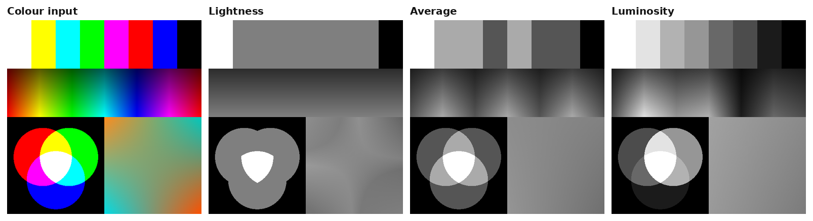
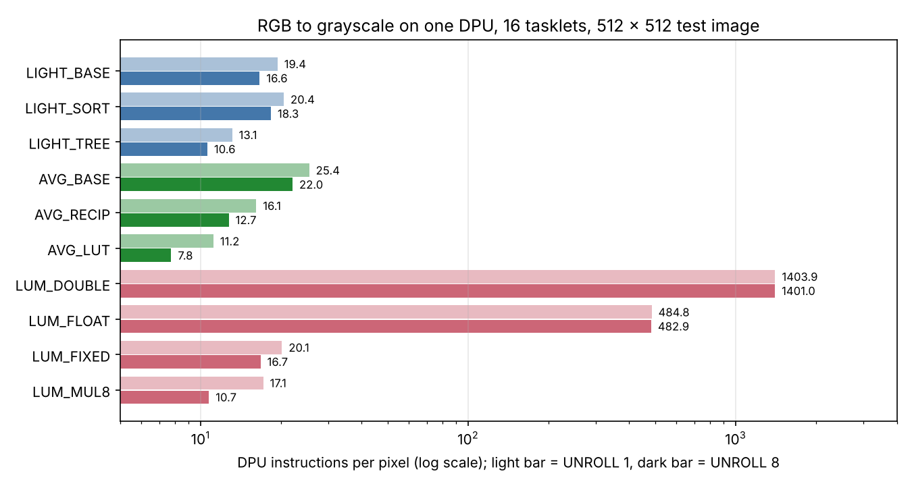

# Programming a Processing-in-Memory Architecture (UPMEM)

A self-study project built on Lab 3 of ETH Zürich's Computer Architecture course (Fall 2025).
It programs UPMEM, the first commercial processing-in-memory (PIM) system: small processors
called DPUs (DRAM Processing Units) sit inside the memory chips, next to the data they work on.

> Everything here ran on the functional simulator of the UPMEM SDK (Software Development Kit).
> Results and instruction counts are exact. No time was measured on real PIM hardware.

| Folder | Contents |
| --- | --- |
| [`grayscale/`](grayscale) | RGB-to-grayscale conversion on DPUs (the lab's bonus task), written from scratch: host program, DPU kernel, ten versions of the three methods, a 1,200-run correctness matrix, experiments and plots |
| [`lab-tasks-1-4/`](lab-tasks-1-4) | Measured results and plots of the four required lab tasks (data transfers, AXPY, operations x data types, parallel reduction). Their source code is not included, because it builds on course template files that may not be redistributed |
| [`docker/`](docker) | Container with UPMEM SDK 2023.1.0 and its simulator |

## Grayscale on a DPU



A DPU is a 32-bit integer core with 24 hardware threads (tasklets), 64 MB of memory (MRAM) and a
64 KB scratchpad (WRAM). It has no floating-point unit, no divider, and only an 8 x 8-bit multiplier.
The three textbook formulas therefore cost very different amounts until they are rewritten for that hardware.

DPU instructions per pixel (one DPU, 16 tasklets, 512 x 512 test image):

| Method | Version | How one pixel is computed | Loop as written | 8 pixels per loop round |
| --- | --- | --- | ---: | ---: |
| Lightness | `LIGHT_BASE` | min and max with 4 comparisons, `(mn + mx) / 2` | 19.4 | 16.6 |
| | `LIGHT_SORT` | order r and g, then place b | 20.4 | 18.3 |
| | **`LIGHT_TREE`** | decision tree over the 6 orderings | 13.1 | **10.6** |
| Average | `AVG_BASE` | `(r + g + b) / 3` | 25.4 | 22.0 |
| | `AVG_RECIP` | `((r + g + b) * 683) >> 11` | 16.1 | 12.7 |
| | **`AVG_LUT`** | 766-byte lookup table | 11.2 | **7.8** |
| Luminosity | `LUM_DOUBLE` | `0.3*r + 0.59*g + 0.11*b` in double | 1403.9 | 1401.0 |
| | `LUM_FLOAT` | the same in float | 484.8 | 482.9 |
| | `LUM_FIXED` | `(77*r + 151*g + 28*b) >> 8` | 20.1 | 16.7 |
| | **`LUM_MUL8`** | the same on the 8 x 8-bit hardware multiplier | 17.1 | **10.7** |



What the measurements show:

- **Floating point is emulated in software.** The lab formula in `float` runs nine library routines per pixel.
  Fixed-point weights and the native multiplier bring Luminosity from 484.8 to 10.7 instructions per pixel (45x).
- **The compiler does not use the 8 x 8 multiplier for constants.** It builds shift-and-add chains (9 instructions for
  the three products). Calling `mul_ul_ul` through the SDK's `built_ins.h` needs 3.
- **A table beats a division.** `r + g + b` has only 766 possible values, so `/ 3` becomes one load.
- **Not every idea helps.** `LIGHT_SORT` needs fewer comparisons on paper but more instructions than the plain version.
- **Tasklets divide the work without adding any.** From 1 to 24 tasklets the instructions per pixel change by less
  than 0.6%. On 64 DPUs the busiest DPU executes 63.5x fewer instructions than a single DPU does alone.
- **Accuracy.** Lightness and Average versions are exact. The fixed-point Luminosity differs from the exact formula
  by at most 1 gray level (checked for all 16.7 million colours).

Every version was verified in 1,200 runs (10 versions x 2 unroll settings x 5 tasklet counts x 3 DPU counts x
4 image sizes): the DPU output equals a CPU reference byte for byte.

## Run it

```bash
./docker/start.sh                 # first run builds the container, then opens a shell in it
cd grayscale
make VERSION=LUM_MUL8 UNROLL=8 NR_TASKLETS=16
./bin/gray_host -i images/test.ppm -d 4 -o out.pgm        # 4 DPUs, writes the gray image

bash scripts/verify.sh            # the 1,200-run correctness matrix
bash scripts/run_experiments.sh   # all experiments -> results/*.csv
python3 scripts/plot.py           # results -> plots/*.png
```

`python3 tools/image_tool.py to-ppm photo.jpg images/photo.ppm` converts any picture to the input format,
and `to-png` turns a result back into a PNG.

Build settings: `VERSION` (the ten names above), `UNROLL` (1, 2, 4, 8), `NR_TASKLETS` (1-24), `BLOCK` (3-9, block = 2^BLOCK pixels).
The number of DPUs is a run-time option (`-d`).

## How it works

- **Layout.** The image stays as interleaved bytes `R G B R G B ...`. MRAM transfers must be multiples of 8 bytes and
  a pixel is 3 bytes, so every size is a multiple of 8 pixels (24 bytes). No reshuffling on the host is needed.
- **Split.** The host gives each DPU an equal share of the pixels. Inside a DPU the share is cut into blocks of
  256 pixels that are dealt out to the tasklets in turn. A tasklet copies a block from MRAM to WRAM (768 bytes),
  converts it, and copies 256 gray bytes back.
- **One formula, two programs.** `common/gray.h` holds the pixel formula and is compiled into both the host program
  and the DPU kernel, so the host can check the DPU result bit for bit. A second check compares against the lab
  formula in exact integer arithmetic and reports the largest error.

## Limits

- Simulator only: it executes DPU instructions exactly but does not model the pipeline or the memory bus.
  On real hardware the run time should fall with the tasklet count up to 11 tasklets and then stay flat.
- The container setup in `docker/` is new and has not been test-built yet; any working UPMEM SDK 2023.1.0
  environment can be used instead.

## References

- J. Gómez-Luna et al., "Benchmarking a New Paradigm: An Experimental Analysis of a Real Processing-in-Memory
  Architecture", arXiv:2105.03814.
- UPMEM SDK: https://sdk.upmem.com and https://github.com/CMU-SAFARI/UPMEM
- ETH Zürich, Computer Architecture (227-2210-00L), Fall 2025, Lab 3: "Programming a Real Processing-in-Memory Architecture".
