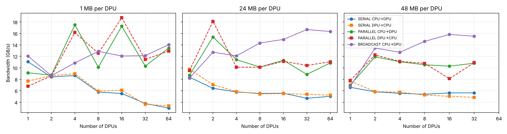
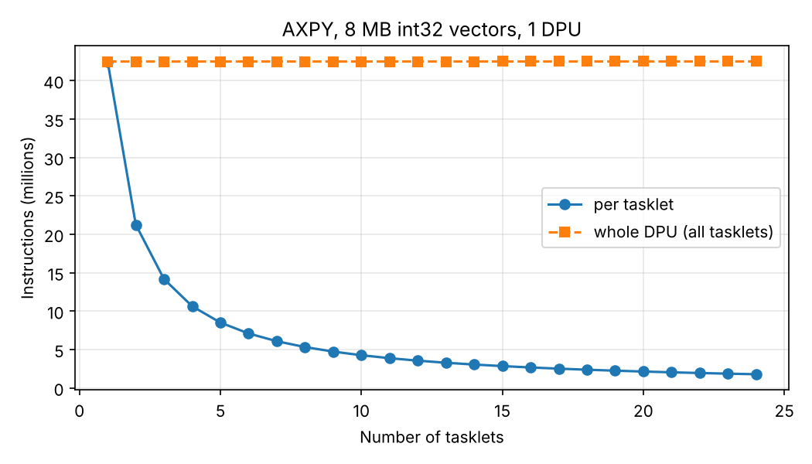
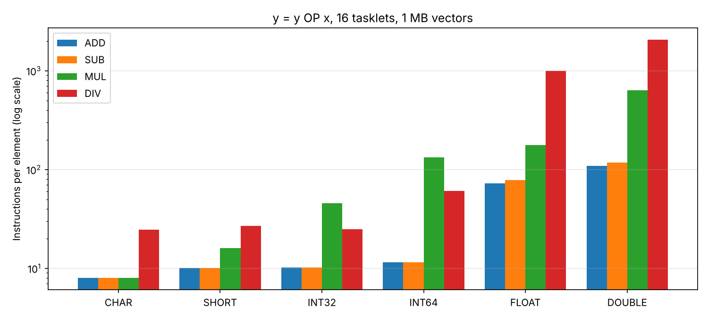
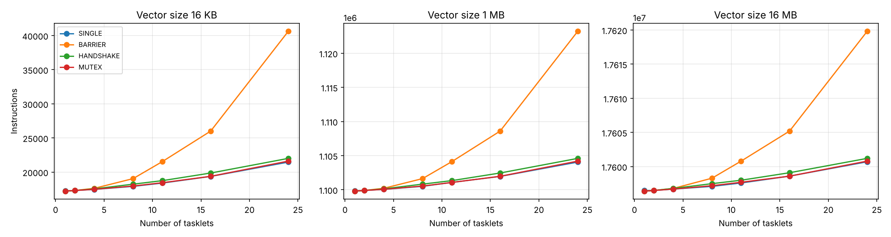

# Lab tasks 1-4: results

Results of the four required tasks of the lab, measured on the UPMEM SDK simulator.
The source code of these tasks is not in this repository: it is built on template files handed out by the
course, which may not be redistributed. `results/` holds the measured numbers, `plots/` the figures, and
`scripts/` the sweep and plotting scripts that produced them (they expect the task folders next to them).

## Task 1: data transfers between host memory and DPU memory

Host code for serial, parallel and broadcast transfers of 1, 24 and 48 MB per DPU on 1 to 64 DPUs.
All transfers were verified by reading the data back.

The simulator copies memory on the host machine, so these bandwidths (a few GB/s, no clear trend) say nothing
about real hardware. The run with 64 DPUs x 48 MB did not fit in the test machine's memory.

## Task 2: AXPY (y = y + alpha * x) with 1 to 24 tasklets

The whole DPU executes about 42.5 million instructions for 2,097,152 32-bit elements whatever the tasklet count,
so the share of one tasklet falls as 1/n. Results were correct for all six data types and for odd vector sizes.

## Task 3: operations x data types

Instructions per element for y = y OP x (16 tasklets, 1 MB vectors):

| Type | ADD | SUB | MUL | DIV |
| --- | ---: | ---: | ---: | ---: |
| char | 8.1 | 8.1 | 8.1 | 24.7 |
| short | 10.1 | 10.1 | 16.1 | 26.8 |
| int32 | 10.2 | 10.2 | 45.6 | 24.9 |
| int64 | 11.5 | 11.5 | 133.5 | 60.9 |
| float | 72.8 | 78.0 | 176.9 | 993.3 |
| double | 109.2 | 117.5 | 631.4 | 2054.0 |

Integer add and subtract are single instructions. Only 8-bit multiplication is native; wider multiplication,
all division and all floating-point operations call library routines.

## Task 4: parallel reduction with four synchronization methods

Instructions on one DPU with 24 tasklets:

| Vector size | Single tasklet | Barrier tree | Handshake tree | Mutex |
| --- | ---: | ---: | ---: | ---: |
| 16 KB | 21,456 | 40,608 | 22,000 | 21,600 |
| 1 MB | 1,104,050 | 1,123,200 | 1,104,590 | 1,104,190 |
| 16 MB | 17,600,700 | 17,619,800 | 17,601,200 | 17,600,800 |

The barrier-based tree costs 89% more on the small vector, because every level makes all tasklets wait.
For larger vectors the final reduction hardly matters: the barrier tree is 1.7% slower at 1 MB and 0.1% slower at 16 MB, and the other three versions are practically equal.
